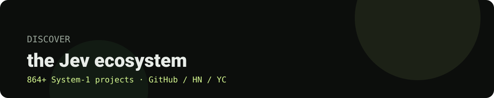

<div align="center">



# JevHub

**Discover project launches from the Jev ecosystem**

[](https://genemcgill.github.io/jevhub/)
[](#data)
[](LICENSE)
[](https://astro.build)

[English](#what-is-this) · [简体中文简介](#简介中文)

</div>

---

## 简介（中文）

JevHub 是 Jev 生态（System-1 agent）的策展目录：**864+ 个项目 · 17 个分类 · 每日更新**。形态上对标 whatships.com 的发布页目录：首页分类芯片筛选 + 卡片网格 + 每个项目独立详情页。数据全部来自零付费官方渠道（GitHub REST API、HN Algolia、awesome-jev-projects），每日采集后静态构建、部署到 GitHub Pages，整站无需后端。

## What is this?

JevHub is a curated directory of the **TypeSafe Jev / System-1 agent ecosystem** — 864+ projects, launch-style, laid out like a launch-video catalog (think [whatships.com](https://whatships.com/) but for the Jev ecosystem). Every entry links back to its GitHub source, its HN/YC discussions, and its review basis.

**864 projects. 17 categories. Zero-paid-API data pipeline.** All data is collected with free, official, compliant sources (GitHub REST API + HN Algolia) and refreshed daily.

Navigation matches the catalog-flow you already know:

- **Discover** — browse all launches by category chips (All / AI / Developer tools / Design / Motion / Productivity / Consumer / Hardware / Other)
- **Videos** — every project has its own `/videos/<slug>/` detail page
- **Tools** — alphabetical index
- **Studios** — teams ranked by stars
- **Submit** — open an issue, no pull request needed

⭐ **If this looks useful, star it** — it helps others find it.

## Data

| Source | What's collected | Status |
|---|---|---|
| [awesome-jev-projects](https://github.com/logicrw/awesome-jev-projects) | 864 curated Jev/System-1 projects (seeded) | ✅ done |
| GitHub REST Search API | `topic:jev` new repos + daily stars | ✅ compliant rate |
| HN Algolia API | "Jev" discussions for detail pages | ✅ daily |
| X / YC (watchlist browse) | posters + real view counts | 🚧 next |

## Architecture

```
collectors (host + sandboxes) ──> outerloop-digest repo ──> astro build ──> gh-pages
```

- **Frontend**: Astro 5 static (869 pages, 1.0s build), no JS framework runtime
- **Data**: JSONL/JSON per-day snapshots in `outerloop-digest` private repo
- **Deploy**: GitHub Pages (`gh-pages` branch), fully decoupled from build infra

## Quick start

```bash
git clone https://github.com/GeneMcGill/jevhub.git
cd jevhub
npm install
npm run dev        # → http://localhost:4321
npm run build      # → dist/ (866 static pages, ~1s)
```

To deploy the built site yourself: publish `dist/` to any static host. No backend needed.

## Design notes

The UI is a deliberate **whatships.com replica** adapted for the Jev ecosystem:

- Dark-first, evidence-light: card posters use first-icon gradient placeholders until real media is collected
- Chips filter all 8 whatships categories; real count updates live
- `llms.txt` + JSON-LD (`Dataset`, `SoftwareApplication`) for AI citation readiness

## Roadmap

- [ ] Real stars/stars24h per project (daily GitHub graph)
- [ ] HN/YC discussion links merged into each `/videos/<slug>/` page
- [ ] X posters + real view counts (watchlist browser telemetry)
- [ ] Custom domain + CNAME

## Contributing

Submissions ride the [awesome-jev-projects issue flow](https://github.com/logicrw/awesome-jev-projects/issues/new?template=project.yml) — no pull requests for catalog changes. Code PRs welcome.

## License

MIT — see [LICENSE](LICENSE).
